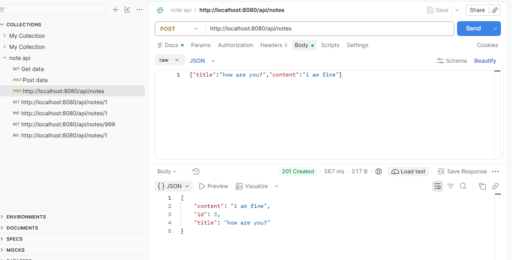
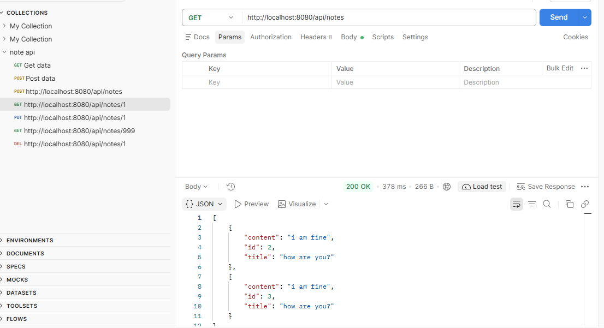
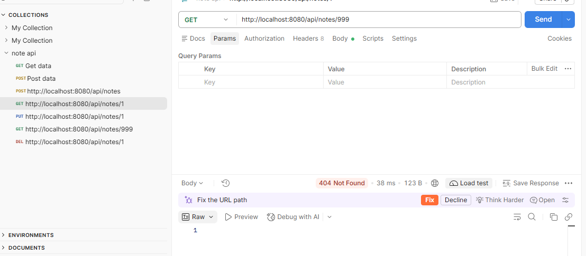
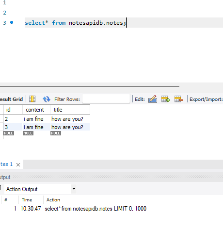

# Notes Management REST API

A REST API for creating and managing notes, built with Java, Spring Boot and MySQL, and tested with Postman. A client sends JSON over HTTP, the server saves it in a MySQL database, and the saved data comes back as JSON.

This is the web-service version of my earlier [Notes Management System](https://github.com/vishwanath8594/Notes-Management-System) (a Java Swing desktop app). The same idea, now exposed as an API that any client can call.

## Tech stack

- Java 17
- Spring Boot (Spring Web, Spring Data JPA / Hibernate)
- MySQL and MySQL Workbench
- Maven
- Postman for testing
- Eclipse IDE, Git and GitHub

## How it works

```
Postman (client)  ->  NoteController  ->  NoteRepository  ->  MySQL
                  <-  JSON response   <-
```

| File | What it does |
|---|---|
| `Note.java` | The entity: one note with `id`, `title` and `content`. JPA creates the `notes` table from this class |
| `NoteRepository.java` | Interface extending `JpaRepository`. Gives save, find and delete without hand-written SQL |
| `NoteController.java` | Receives HTTP requests, calls the repository, returns JSON with the right status code |

## API endpoints

Base URL: `http://localhost:8080/api/notes`

| Method | Endpoint | What it does | Success status | Not found |
|---|---|---|---|---|
| POST | `/api/notes` | Create a note | 201 Created | |
| GET | `/api/notes` | Get all notes | 200 OK | |
| GET | `/api/notes/{id}` | Get one note | 200 OK | 404 |
| PUT | `/api/notes/{id}` | Update a note | 200 OK | 404 |
| DELETE | `/api/notes/{id}` | Delete a note | 204 No Content | 404 |

Example request body for POST and PUT:

```json
{
  "title": "Meeting",
  "content": "Talk about API design"
}
```

Example response (201 Created):

```json
{
  "id": 1,
  "title": "Meeting",
  "content": "Talk about API design"
}
```

## Screenshots

**Create a note (POST, 201 Created)**



**Get all notes (GET, 200 OK)**



**Note not found (GET, 404)**



**Saved rows in MySQL**



## How to run it

**You need:** JDK 17 or higher, MySQL Server, MySQL Workbench, Postman.

1. Clone the repo:
   ```
   git clone https://github.com/vishwanath8594/notes-management-api.git
   ```
2. In MySQL Workbench, create the database:
   ```sql
   CREATE DATABASE notesapidb;
   ```
   The `notes` table is created automatically when the app starts.
3. Go to `src/main/resources`, copy `application.properties.example.properties` and name the copy `application.properties`. Fill in your own MySQL details:
   ```properties
   spring.datasource.url=jdbc:mysql://localhost:3306/notesapidb
   spring.datasource.username=root
   spring.datasource.password=YOUR_PASSWORD
   spring.jpa.hibernate.ddl-auto=update
   spring.jpa.show-sql=true
   server.port=8080
   ```
   `application.properties` is listed in `.gitignore`, so your real password is never uploaded.
4. Start the app, either:
   - in Eclipse: right-click `NotesapiApplication.java` -> **Run As -> Java Application**, or
   - from a terminal in the project folder: `mvnw.cmd spring-boot:run` (Windows) or `./mvnw spring-boot:run` (Mac/Linux)
5. Wait for `Started NotesapiApplication` in the console.
6. Import the Postman collection included in this repo (`note api.postman_collection.json`) and send the requests.

## Problems I debugged while building this

| Symptom | Cause | Fix |
|---|---|---|
| `404 Not Found` on `/api/notes` even though the app was running | The entity, repository and controller files were empty, so Spring registered no controller | Added the code to all three classes and restarted the app |
| `Web server failed to start. Port 8080 was already in use` | An earlier run of the app was still holding the port | Terminated the old run from the Eclipse console and started the app once |
| Postman showed `ECONNREFUSED 127.0.0.1:8080` | The app was not running (the console showed `<terminated>`) | Started the app again and waited for "Started NotesapiApplication" |
| MySQL Error 1146, table doesn't exist | The SQL query used a different database name than the one in `application.properties` | Used the same database name (`notesapidb`) in both places |
| App crashed on startup with `Access denied for user 'root'@'localhost'`, and Postman showed `ECONNREFUSED` | The MySQL password in `application.properties` was wrapped in quote marks, which MySQL received as part of the password | Removed the quotes from the password line and restarted the app |

## Limitations and next steps

- No authentication yet, so the API is open to anyone who can reach it
- No input validation yet (for example, rejecting an empty title with 400 Bad Request)
- Controller talks to the repository directly; a service layer is the next improvement

## Author

Vishwanath S
